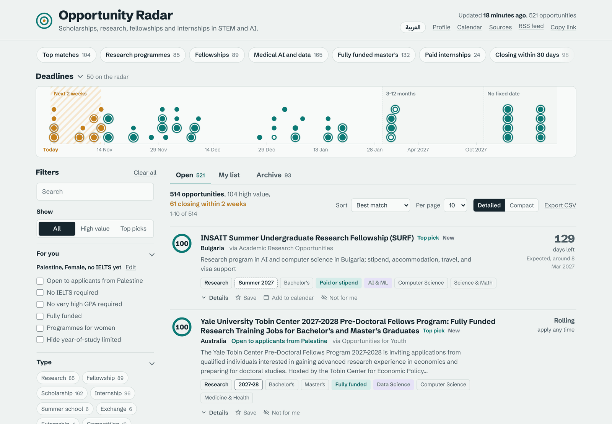
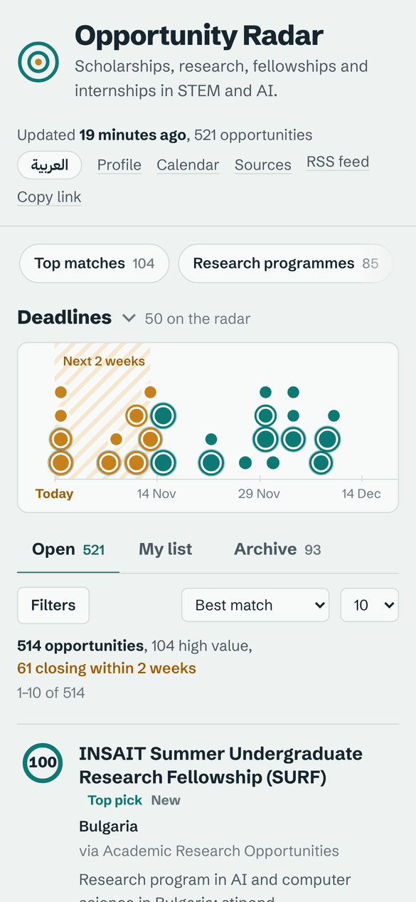
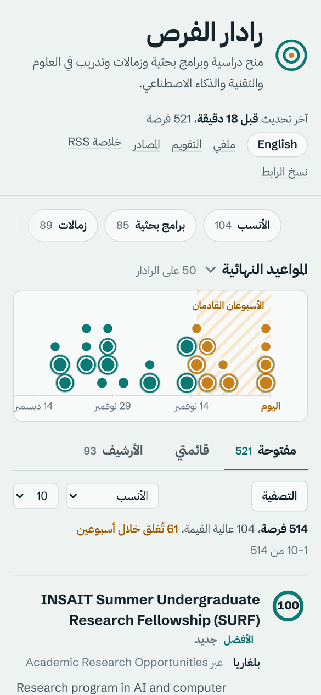

# Opportunity Radar

**Scholarships, research programmes, fellowships and internships in STEM, data science and AI, collected from 9 sources, ranked by value and refreshed every hour.**

### [→ Open Opportunity Radar](https://malakbattat.github.io/opportunity-radar/)

English and Arabic · Works on phones · Free, no sign-up

[](https://malakbattat.github.io/opportunity-radar/)

<div dir="rtl">

**رادار الفرص**: منح دراسية وبرامج بحثية وزمالات وتدريب في العلوم والتقنية والذكاء الاصطناعي، تُجمع من ٩ مصادر وتُرتّب حسب قيمتها وتُحدَّث كل ساعة. الموقع متاح بالعربية: اضغط على «العربية» في أعلى الصفحة.

</div>

---

## Why it exists

Good opportunities are scattered across dozens of sites, buried among expired posts, fee-charging events
and listings only open to one nationality. Opportunity Radar reads those sites every hour, merges the
duplicates, drops what's expired and **ranks the rest** for a final-year undergraduate or recent graduate
heading towards research and a master's, with extra weight on AI, medical AI and data science, on full
funding, and on programmes that welcome applicants from Palestine and the wider Arab region.

## What you can do on the site

| | |
|---|---|
| **Start with a quick view** | Top matches, Research programmes, Fellowships, Medical AI and data, Fully funded master's, Paid internships, Closing within 30 days, New this week. |
| **Watch the deadlines** | The radar at the top shows high-value deadlines over the next 90 days, plus every opportunity scoring 80+ further out. Click a dot to open it. |
| **Filter for yourself** | Set your nationality, gender and IELTS score under **Profile**, then use **For you**: open to applicants from your country, no IELTS required, no very high GPA required, fully funded, programmes for women. Plus type, level, deadline, intake (semester and year), destination, field, funding and source. |
| **See why something ranks high** | Every listing has a score from 0 to 100. **Details** shows how it was worked out, who can apply, and every site it appears on. |
| **Keep track** | **Save** an opportunity to **My list**, mark it Applying or Applied, and work through its application checklist (CV, statement, references, transcript…) with notes and a target date. |
| **Never miss a deadline** | **Calendar** subscribes Google, Apple or Outlook Calendar to the deadlines, with reminders a week and a day before. |
| **Look back** | **Archive** keeps closed programmes for a year, with the date the next round is expected; reopened ones return to the list marked *Reopened*. |
| **Share** | **Copy link** shares the exact view you're looking at, filters included. |

> Every listing links to its original post. Details are read automatically from listing text, so always
> confirm the deadline and eligibility on the official page before applying.

**Your data stays with you.** There are no accounts and no tracking. Saved items, checklists and your
profile are kept in your own browser and never leave it.

<p align="center">
  
  &nbsp;&nbsp;
  
</p>

## Sources

| Source | What it adds |
|---|---|
| [Opportunities for Youth](https://opportunitiesforyouth.org) · [Opportunity Portal](https://opportunityportal.info) · [Scholarships Corner](https://scholarshipscorner.website) | Scholarships, fellowships, internships and programmes worldwide |
| [ScholarshipsAds](https://www.scholarshipsads.com) | Master's and PhD scholarships, with language and GPA requirements |
| [Foras](https://foras.ps) | Opportunities for Arab and Palestinian applicants |
| [Research Internships for Undergraduates](https://github.com/zapplyjobs/Research-Internships-for-Undergraduates) | Undergraduate research programmes by country |
| [Academic Research Opportunities for International Students](https://github.com/smsnobin77/Academic-research-opportunities-for-international-students) | Summer research programmes open to international students |
| [CS Everything but Internships](https://github.com/Julian048/CS-Everything-but-Internships) | Fellowships, externships and programmes for CS students |
| [Zapply Internships 2027](https://github.com/zapplyjobs/Internships-2027) | US tech internships that sponsor visas. Credited and linked as Zapply asks, and kept out of the RSS feed |

**Sources** on the site shows when each one was last read. Listings and summaries belong to their sites;
Opportunity Radar only points to them.

---

## Run your own copy

Interested in different fields or a different country? Make your own radar in about five minutes. It runs
entirely on GitHub's free tier: no server, no database, no API keys.

1. **Fork** this repository (keep it public so GitHub Actions minutes are free).
2. **Settings → Pages → Build and deployment → Source: GitHub Actions.**
3. **Actions** tab → enable workflows → *Update opportunities and publish site* → **Run workflow**.
   The first run takes about three minutes.
4. Your site is live at `https://<your-username>.github.io/opportunity-radar/`. Put that address in
   `site.base_url` in [`config.yaml`](config.yaml).
5. Edit **`config.yaml`** to make it yours: the `profile` (nationality, gender, IELTS score), the
   interest `fields` and their weights, `prestige` names, and which `sources` are switched on.
   Every change re-scores everything on the next run.

From then on it updates **every hour**: 23 quick checks of each site's newest listings and one deep scan
a day (04:23 UTC). The site is republished every hour, but a commit is only made when the listings
actually change.

<details>
<summary><b>All <code>config.yaml</code> settings</b></summary>

| Setting | What it does |
|---|---|
| `profile` | Who the ranking is for: nationality, gender, IELTS score, bonuses by type (Research, Fellowship…), for programmes open to current undergraduates and final-year students; penalties for bachelor's-entry scholarships, PhD-only programmes, year-limited programmes and listings closed to your nationality. |
| `fields` | Interest areas, each with a `weight` and keyword list. |
| `funding` | Points for fully funded, paid and partial funding; a penalty for fee-based events. |
| `prestige` | Universities, organisations and companies that earn a bonus. |
| `degree_bonus` | Extra points per level (master's is boosted by default). |
| `open_field` | Bonus for awards open to every field (Gates Cambridge, Rhodes…). |
| `very_competitive` | Programmes marked "Top grades expected" even when the listing doesn't say so. |
| `ignore_phrases` | Phrases ignored when matching, e.g. "health insurance" so it doesn't count as a health topic. |
| `off_topic` | Small penalty for clearly unrelated areas when nothing else matched. |
| `high_value`, `top_pick`, `runway_shelf_min`, `min_score` | Score thresholds for the badges, the radar and what's shown at all. |
| `sources` | Turn sources on or off, pages to read, and per-source rules. |
| `schedule` | Which hour runs the deep scan, and how much a quick check reads. |
| `retention` | When items move to the archive and how long it keeps them. |

To change how often it runs, edit the `cron` line in [`.github/workflows/update.yml`](.github/workflows/update.yml):
`"23 * * * *"` is hourly, `"23 */3 * * *"` every three hours.

</details>

## For developers

```bash
python -m venv .venv && source .venv/bin/activate      # Windows: .venv\Scripts\activate
pip install -r requirements.txt
python -m playwright install chromium                   # only needed for Foras
python -m scraper.run                                   # fetch + score → docs/data/opportunities.json
python -m http.server -d docs 8000                      # open http://localhost:8000
python -m pytest -q                                     # offline tests on saved sample pages
```

`python -m scraper.run --only scholarshipsads,opportunityportal -v` reads just those sources;
`--mode quick|full` picks the scan depth.

```
GitHub Actions, hourly
  scraper/sources.py        WordPress REST API (RSS fallback), ScholarshipsAds pages,
                            headless browser for Foras
  scraper/github_lists.py   the four curated GitHub lists
  scraper/classify.py       type · level · fields · funding · deadline · intake · country ·
                            eligibility · language and GPA requirements · score
  scraper/run.py            merge duplicates · history · archive · JSON, RSS and calendar files
  → docs/ deployed to GitHub Pages (plain HTML, CSS and JavaScript, no build step)
```

A source that fails doesn't break anything: its previous listings are kept and **Sources** shows the
error. Two more adapters are included but switched off in `config.yaml`, because those sites block
automated reads from GitHub: For9a and the DAAD scholarship database.

To add a WordPress site it's one line in `build_sources()`:
`WordPressSource("key", "https://example.org")`; any other site needs a class with a `fetch()` method
returning `title`, `url` and whatever else it has (`body`, `summary`, `deadline_text`, `categories`…),
plus an entry in `SOURCE_META`.

The scraper identifies itself, pauses between requests, reads only listing pages and a limited number of
detail pages, and always links back to the original post.
